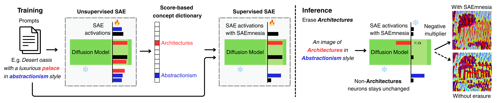

<div align="center">

<h1>SAEmnesia</h1>

<p><strong>SAEmnesia: Erasing Concepts in Diffusion Models with Supervised Sparse Autoencoders</strong></p>

<p>
  <a href="https://eidoslab.github.io/SAEmnesia">Project Page</a> •
  <a href="https://arxiv.org/abs/2509.21379">Paper (ICML 2026)</a>
</p>

<p>
  
  
</p>

</div>

<div align="center">
  
</div>

---

## Repository Structure

```
SAEmnesia/
├── SAE/                          # SAE architecture and hooked diffusion pipelines
├── utils/                        # Unlearning hook implementations
├── UnlearnCanvas_resources/      # Class / style lists from UnlearnCanvas
├── scripts/
│   ├── download_checkpoint.py           # Download SAE checkpoint from HuggingFace
│   ├── sample_unlearning_cls_distr.py   # Step 1: generate images with unlearning
│   ├── run_acc_all_cls.py               # Step 2: run full evaluation pipeline
│   ├── accuracy_unlearncanvas_cls_fast.py
│   ├── avg_accuracy_cls.py
│   ├── finetuning/
│   │   └── sae_finetuning.py            # Supervised SAE finetuning
│   └── dataset/                  # (coming soon)
└── requirements.txt
```

---

## Setup

```bash
git clone https://github.com/EIDOSLAB/SAEmnesia.git
cd SAEmnesia
pip install -r requirements.txt
```

---

## Pretrained Assets

Download the following files and place them wherever you prefer (paths are passed as CLI arguments):

| Asset | Source |
|-------|--------|
| SAE checkpoint | [leno3003/SAEmnesia](https://huggingface.co/leno3003/SAEmnesia) on HuggingFace — see below |
| `class_params.pth` | [Google Drive](https://drive.google.com/drive/folders/1NoFDrjJ3dYmadufV2pK203ZED2pZ_hsB?usp=sharing) — see below |
| `cls_latents_dict_unet.up_blocks.1.attentions.1.pkl` | [Google Drive](https://drive.google.com/drive/folders/1NoFDrjJ3dYmadufV2pK203ZED2pZ_hsB?usp=sharing) — see below |
| UnlearnCanvas diffusion model (`style50`) | [Google Drive](https://drive.google.com/drive/folders/18tN-7LuxQ89I-MDSjtB5to2dGHDMHyqb) — see below |
| `style50.pth` and `style50_cls.pth` (classifiers) | [Google Drive](https://drive.google.com/drive/folders/1AoazlvDgWgc3bAyHDpqlafqltmn4vm61) — see below |

### Downloading the SAE checkpoint

Use the provided script to download the checkpoint from HuggingFace:

```bash
python scripts/download_checkpoint.py /path/to/save/sae_checkpoint
```

The checkpoint will be saved to the directory you specify (created automatically if it does not exist).

### Downloading the UnlearnCanvas diffusion model

```bash
gdown --folder https://drive.google.com/drive/folders/18tN-7LuxQ89I-MDSjtB5to2dGHDMHyqb \
    -O /path/to/save/style50
```

### Downloading the classifiers (`style50.pth` and `style50_cls.pth`)

```bash
gdown --folder https://drive.google.com/drive/folders/1AoazlvDgWgc3bAyHDpqlafqltmn4vm61 \
    -O /path/to/save/classifiers
```

### Downloading `class_params.pth` and `cls_latents_dict_unet.up_blocks.1.attentions.1.pkl`

```bash
gdown --folder "https://drive.google.com/drive/folders/1NoFDrjJ3dYmadufV2pK203ZED2pZ_hsB?usp=sharing" \
    -O /path/to/save/sae_assets
```

---

## Reproducing the Main Results

### Step 1 — Generate images with SAEmnesia unlearning

```bash
accelerate launch --num_processes <N_GPUS> scripts/sample_unlearning_cls_distr.py \
    --pipe_checkpoint /path/to/unlearncanvas/style50 \
    --hookpoint unet.up_blocks.1.attentions.1 \
    --sae_checkpoint /path/to/sae_checkpoint \
    --class_latents_path /path/to/cls_latents_dict_unet.up_blocks.1.attentions.1.pkl \
    --class_params_path /path/to/class_params.pth \
    --seed 188 \
    --steps 100 \
    --output_dir /path/to/output/images
```

### Step 2 — Evaluate unlearning accuracy (UA, IRA, CRA)

```bash
PYTHONPATH=. python scripts/run_acc_all_cls.py \
    --input_dir /path/to/output/images \
    --output_dir /path/to/output/eval_results \
    --style_ckpt /path/to/classifier_checkpoints/style50.pth \
    --class_ckpt /path/to/classifier_checkpoints/style50_cls.pth \
    --batch_size 128
```

This prints **UA** (Unlearning Accuracy), **IRA** (In-domain Retention Accuracy), and **CRA** (Cross-domain Retention Accuracy).

---

## Supervised SAE Finetuning

`scripts/finetuning/sae_finetuning.py` is the training script used to obtain the supervised SAE.
Each object and style concept is assigned to a dedicated latent, either from pre-computed concept
scores or randomly when training from scratch (`--from_scratch`). 

### Expected inputs

`--activations_dir` must point to a directory of cached concept activations organized per hookpoint,
where the hookpoint name is the *directory name* of `--checkpoint_path`:

```
<activations_dir>/
└── unet.up_blocks.1.attentions.1/            # hookpoint
    ├── metadata/
    │   └── recovered_object_to_style_index.json
    ├── <concept_1>/                          # HF dataset (save_to_disk format)
    └── <concept_2>/
```

`--object_scores_json_path` and `--style_scores_json_path` are the pre-computed concept scores used
for the latent assignment. They are still required as arguments when `--from_scratch` is used, but the
files do not need to exist in that case (assignment falls back to random).

### Training command

```bash
torchrun --nproc_per_node <N_GPUS> scripts/finetuning/sae_finetuning.py \
    --checkpoint_path /path/to/sae_checkpoint/unet.up_blocks.1.attentions.1 \
    --activations_dir /path/to/concept_activations \
    --object_scores_json_path /path/to/scores/objects/scores.json \
    --style_scores_json_path /path/to/scores/styles/scores.json \
    --save_dir /path/to/output/finetuned_sae \
    --device cuda \
    --learning_rate 5e-6 \
    --num_epochs 150 \
    --batch_size 128 \
    --reconstruction_weight 1.0 \
    --cross_entropy_weight 3.0 \
    --sparsity_weight 0.01 \
    --orthogonality_weight 0.1 \
    --seed 42 \
    --validation_split 0.2 \
    --mixed_batches \
    --num_gpus <N_GPUS> \
    --gradient_accumulation_steps 1 \
    --mixed_precision \
    --patience 5 \
    --resume \
    --from_scratch
```

Notes:

- `--num_gpus` must match `--nproc_per_node`. Drop `torchrun` and run the script with `python` for single-GPU training.
- `--mixed_precision` trains with AMP: fp32 weights, autocast compute and a gradient scaler.
- `--resume` restarts from `<save_dir>/current/<hookpoint>` if a checkpoint is there, `--from_scratch` initializes a new SAE instead of loading `--checkpoint_path`.
- Checkpoints are written to `<save_dir>/best/<hookpoint>` (lowest validation loss) and `<save_dir>/current/<hookpoint>` (last epoch); pass `<save_dir>/best` as `--sae_checkpoint` in Step 1.
- W&B logging runs in offline mode and is stored under `<save_dir>/wandb`.

---

## Citation

```bibtex
@InProceedings{pmlr-v306-cassano26a,
  title = 	 {{SAE}mnesia: Erasing Concepts in Diffusion Models with Supervised Sparse Autoencoders},
  author =       {Cassano, Enrico and Renzulli, Riccardo and Nurisso, Marco and Zaffaroni, Mirko and Perotti, Alan and Grangetto, Marco},
  booktitle = 	 {Proceedings of the 43rd International Conference on Machine Learning},
  pages = 	 {12001--12023},
  year = 	 {2026},
  editor = 	 {Zhang, Tong and Dudik, Miroslav and Jaggi, Martin and Agarwal, Alekh and Li, Sharon and Schuurmans, Dale and Zhu, Jerry and Berkenkamp, Felix and Dong, Hanze and Bietti, Alberto},
  volume = 	 {306},
  series = 	 {Proceedings of Machine Learning Research},
  month = 	 {06--11 Jul},
  publisher =    {PMLR},
  pdf = 	 {https://raw.githubusercontent.com/mlresearch/v306/main/assets/cassano26a/cassano26a.pdf},
  url = 	 {https://proceedings.mlr.press/v306/cassano26a.html},
}

```

---

## Acknowledgements

This work builds upon [SAeUron](https://github.com/cywinski/SAeUron) by Cywinski et al. We thank the authors for releasing their code.

---

<div align="center">
<sub>© 2026 EIDOSLab — University of Turin</sub>
</div>
